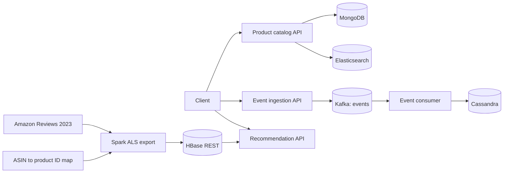

# Distributed E-Commerce Recommendation Analytics System

A local research prototype for product search, event ingestion, and recommendations, built on MongoDB, Elasticsearch, Kafka, Cassandra, HBase, and Spark. All results come from real Amazon Reviews 2023 data; missing datasets are reported as missing, never replaced with generated records. This is not a production service.

## Architecture



| Component | Code | Storage | Port |
| --- | --- | --- | ---: |
| Product API and dashboard | `services/product_service/app/main.py` | MongoDB, Elasticsearch | 8000 |
| Event API (`event-api`) | `src/ecommerce_analytics/main.py` | Kafka topic `events` | 8002 |
| Event consumer | `src/ecommerce_analytics/event_consumer.py` | Cassandra `events_by_user` | – |
| Recommendation API (`recommendation-api`) | `src/ecommerce_analytics/recommendation_api.py` | HBase `als_recommendations` | 8003 |
| ALS export | `src/ecommerce_analytics/als_export.py` | JSON part files | – |
| HBase loader | `src/ecommerce_analytics/hbase_recommendations.py` | HBase REST | – |

- **Product API:** `/products` (create, list), `/products/{id}`, `/products/count`, `/products/search?q=`, `/metrics/amazon-ratings`, `/health`, and the dashboard at `/dashboard/`. Reads come from MongoDB, and search goes through Elasticsearch.
- **Event API:** `POST /events` takes `user_id`, `product_id`, `event_type` (`view`, `add_to_cart`, or `purchase`), and an optional timezone-aware `occurred_at`. It publishes the event to Kafka and returns `202`. `GET /users/{id}/events` returns one user's recent events.
- **Consumer:** auto-commit is off. The consumer commits a Kafka offset only after the event is written to Cassandra.
- **Dashboard:** shows the catalog count, the rating distribution, search, and one user's recommendations and events. A panel shows "unavailable" when its service or data is missing.

See [the architecture notes](docs/architecture.md) for details.

## Data

| Dataset | Status |
| --- | --- |
| [Amazon Reviews 2023](https://amazon-reviews-2023.github.io/) ([Hugging Face](https://huggingface.co/datasets/McAuley-Lab/Amazon-Reviews-2023)) | Used for the catalog, review analysis, ALS, and rating models |
| [RetailRocket](https://www.kaggle.com/datasets/retailrocket/ecommerce-dataset) | Not in this checkout; its IDs have no verified link to Amazon IDs |


| File | Used by |
| --- | --- |
| `data/amazon_products.json` | Catalog import, indexing, benchmark |
| `data/asin_product_id_map.json` | Catalog import, ALS export, evaluation |
| Review CSV (`user_id`, `asin`, `rating`, `timestamp`), default `data/catalog_reviews.csv` | Rating endpoint, ALS export, recommendation evaluation |
| Review CSV or `.jsonl.gz` category file | Descriptive report, rating sensitivity |

`asin` is Amazon's product key; `product_id` is this project's integer catalog key. Field details are in [the data source notes](docs/dashboard-data-sources.md).

## Setup

Requires Python 3.10+, Docker with Compose, and Java 17+ (for Spark only).

```sh
python -m venv .venv && source .venv/bin/activate
python -m pip install -e '.[dev,als]'   # drop ",als" if you don't need Spark
docker compose up -d                    # MongoDB 27017, Elasticsearch 9200, Kafka 9094, Cassandra 9042, HBase REST 8080
```

Settings are read from environment variables. The defaults match the Compose services, and [`.env.example`](.env.example) lists the service settings. The code does not load that file automatically. The rating endpoint reads `AMAZON_REVIEWS_PATH`, which defaults to `data/catalog_reviews.csv`.

## Run

Start each process in its own terminal:

```sh
PYTHONPATH=src uvicorn services.product_service.app.main:app   # http://127.0.0.1:8000/dashboard/
event-api
python -m ecommerce_analytics.event_consumer
recommendation-api
```

Load the catalog into MongoDB and Elasticsearch:

```sh
PYTHONPATH=src python -m services.product_service.import_catalog
PYTHONPATH=src python -m services.product_service.index_catalog
```

Build and load recommendations:

```sh
PYTHONPATH=src python -m ecommerce_analytics.als_export \
  --reviews "$AMAZON_REVIEWS_PATH" --catalog-map data/asin_product_id_map.json \
  --output data/als_recommendations --top-k 10
PYTHONPATH=src python -m ecommerce_analytics.hbase_recommendations --input data/als_recommendations
curl http://localhost:8003/recommendations/<amazon-user-id>
```

Recommendations are keyed by Amazon `user_id` and return mapped `product_id` values.

## Research commands

Run each with `PYTHONPATH=src`:

| Command | Output |
| --- | --- |
| `python -m ecommerce_analytics.dataset_audit --reviews R --catalog C --catalog-map M` | Join coverage between reviews, catalog, and ID map |
| `python -m ecommerce_analytics.research_report --reviews R --output FILE` | Rating distribution, reviews per product, time range |
| `python -m ecommerce_analytics.recommendation_evaluation --reviews R --catalog-map M` | ALS vs. popularity: Recall@K, NDCG@K, coverage |
| `python -m ecommerce_analytics.rating_sensitivity --input R` | Random forest vs. mean baseline across time cutoffs and seeds |
| `python -m services.product_service.catalog_benchmark --sizes 100 300 1000` | Elasticsearch bulk indexing time |

Evaluation rules are set in [the research questions](docs/research_questions.md). Recommendations hold out each user's latest review. Rating models use one global time split, and each feature uses only strictly earlier reviews.

## Research questions

The answers below are pilot results on real data. Their full methods and limits are in [the research report](docs/research_report.md).

### 1. How are review ratings distributed?

Ratings are heavily positive. Across 4,500,228 reviews of 7,675 products (2000–2023), the shares are:

| Rating | 1 | 2 | 3 | 4 | 5 |
| --- | ---: | ---: | ---: | ---: | ---: |
| Share | 6.55% | 3.79% | 5.96% | 12.36% | 71.34% |

The weighted mean is 4.38. Because the mean sits so close to the top of the scale, it says little without the distribution beside it.

### 2. How evenly are reviews spread across products?

Unevenly. The median product has 253 reviews, the 90th percentile has 1,304, and counts range from 38 to 39,313. Product averages therefore rest on very different amounts of evidence.

### 3. Does ALS recommend better than simple popularity?

Not in this pilot. On a deterministic 1% user sample (13,424 evaluated users, latest review held out, K=10), popularity ranks held-out products better, while ALS covers far more of the catalog ([details](docs/recommendation_evaluation.md)).

| Method | Recall@10 | NDCG@10 | Coverage@10 |
| --- | ---: | ---: | ---: |
| ALS | 1.29% | 0.66% | 2.49% |
| Popularity | 2.27% | 1.21% | 0.18% |

ALS ran for only 2 iterations, the comparison has no significance test, and the metrics have not been reproduced since the original run.

### 4. Can a reviewer's and product's history predict a review's rating?

Slightly, yes. On 16,216 Subscription Boxes reviews, a 30-tree random forest beat a baseline that always predicts the training mean. Its features were earlier review counts and mean ratings for the reviewer and the product, plus the review month. Forest values below are means over 3 seeds ([raw results](results/tabular_rating_sensitivity.json)).

| Cutoff | Train / test | MAE (baseline → forest) | RMSE (baseline → forest) |
| ---: | ---: | ---: | ---: |
| 70th pct | 11,208 / 5,008 | 1.3929 → 1.3648 | 1.5878 → 1.5667 |
| 80th pct | 12,849 / 3,367 | 1.3944 → 1.3776 | 1.5789 → 1.5582 |
| 90th pct | 14,432 / 1,784 | 1.3790 → 1.3366 | 1.5586 → 1.5228 |

The forest had lower error in all 9 runs, and every paired bootstrap interval for the error difference is below zero. The gain is small, though: 1.2–3.1% in MAE and 1.3–2.3% in RMSE, within one product category.

### 5. Is that improvement stable?

Across model seeds, yes. At each cutoff, the forest's MAE varies by at most 0.0042 between seeds. The size of the gain depends more on where the time cutoff falls: the MAE reduction was 2.02%, 1.21%, and 3.08% at the 70th, 80th, and 90th percentiles. The cutoffs share reviews, so these are sensitivity checks, not independent replications.

### 6. How does catalog indexing time grow with batch size?

Slowly at this scale. Indexing 100, 300, and 1,000 real products took a median 0.136 s, 0.151 s, and 0.270 s. Ten times the products took about twice as long, so throughput rose from 736 to 3,699 products/s. The timer includes deleting the temporary index, and this is one local node, not a production benchmark ([details](docs/scalability.md)).

### Open questions

These need data or endpoints the project doesn't have yet. View-to-cart and cart-to-purchase rates need the RetailRocket files. Event volume across all users needs an aggregate endpoint, because Cassandra is currently read one user at a time.

## Tests

```sh
python -m pytest -q
```

Real-data tests skip unless their file path is set (for example `AMAZON_REVIEWS_PATH`). Tests marked `integration` need the Compose services. [CI](.github/workflows/integration.yml) runs the suite against MongoDB, Elasticsearch, and HBase on pushes to `main` and on pull requests.

## Limitations

- Single-node local services, with no cluster, load, or failure testing.
- No Prometheus or Grafana, and no metrics endpoint.
- RetailRocket analyses are blocked until its files and an ID crosswalk exist.
- Events can be read for one user at a time only, so there are no global event aggregates.
- The recommendation pilot is small and unreproduced, and the rating study covers one category.

## License

[MIT](LICENSE)
