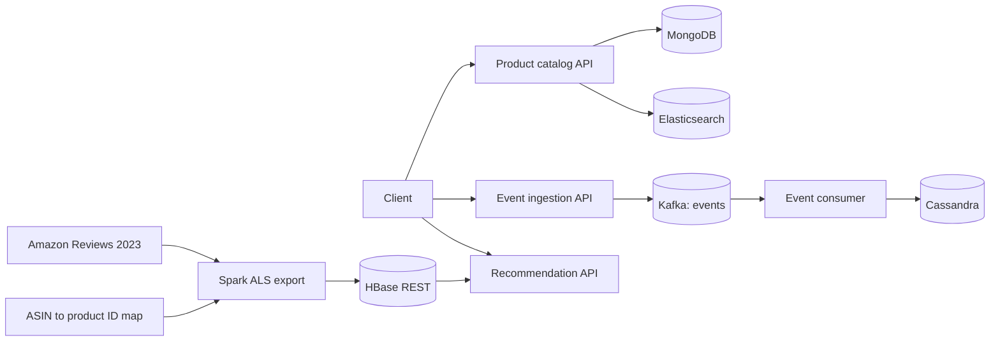

# Distributed E-Commerce Recommendation Analytics System

This repository contains a local research prototype for product search, recommendations, and e-commerce event analysis. Python services sit on top of five data stores (MongoDB, Elasticsearch, Kafka, Cassandra, and HBase), and offline jobs use Spark to train and evaluate models on real Amazon review data.

The code is meant for research and local development. It is not a hosted production service, and every reported result comes from real source data. Missing datasets are reported as missing rather than replaced with generated records.

## Contents

- [System overview](#system-overview)
- [Components](#components)
- [Data sources](#data-sources)
- [Setup](#setup)
- [Running the services](#running-the-services)
- [Recommendation pipeline](#recommendation-pipeline)
- [Research workflows](#research-workflows)
- [Results so far](#results-so-far)
- [Testing](#testing)
- [Repository layout](#repository-layout)
- [Limitations](#limitations)
- [Further reading](#further-reading)

## System overview



There are three request paths:

1. **Catalog.** The product API stores product records in MongoDB and indexes them in Elasticsearch. Reads by ID come from MongoDB, and text search goes through Elasticsearch.
2. **Events.** The event API validates user interactions and publishes them to the Kafka `events` topic. A separate consumer validates each message, writes it to Cassandra, and only then commits the Kafka offset.
3. **Recommendations.** An offline Spark job trains ALS on Amazon reviews and exports top-K recommendations. A loader writes them to HBase through its REST gateway, and the recommendation API reads them by user ID.

Docker Compose runs the data stores. The APIs and the consumer run as ordinary local processes. More detail is in [the architecture notes](docs/architecture.md).

## Components

| Component | Code | Storage | Default port |
| --- | --- | --- | ---: |
| Product catalog API and dashboard | `services/product_service/app/main.py` | MongoDB, Elasticsearch | 8000 |
| Event ingestion API | `src/ecommerce_analytics/main.py` (`event-api`) | Kafka | 8002 |
| Event consumer | `src/ecommerce_analytics/event_consumer.py` | Kafka → Cassandra | none |
| Recommendation API | `src/ecommerce_analytics/recommendation_api.py` (`recommendation-api`) | HBase REST | 8003 |
| ALS export job | `src/ecommerce_analytics/als_export.py` | Spark, writes JSON part files | none |
| HBase loader | `src/ecommerce_analytics/hbase_recommendations.py` | HBase table `als_recommendations` | none |

### Product catalog API

| Method | Path | Purpose |
| --- | --- | --- |
| `GET` | `/health` | Liveness check |
| `POST` | `/products` | Create a product in MongoDB and index it in Elasticsearch |
| `GET` | `/products` | List products |
| `GET` | `/products/count` | Number of catalog records |
| `GET` | `/products/search?q=...` | Full-text search through Elasticsearch |
| `GET` | `/products/{product_id}` | Fetch one product |
| `GET` | `/metrics/amazon-ratings` | Rating distribution from the configured Amazon review file |
| `GET` | `/dashboard/` | Static dashboard page |

`/metrics/amazon-ratings` reads the file at `AMAZON_REVIEWS_PATH` (default `data/catalog_reviews.csv`, relative to the working directory) and caches the totals in memory. The first call after a restart has to scan the whole file, so it can take a while on a large extract.

### Event API and consumer

`POST /events` accepts a JSON body with `user_id` and `product_id` (positive integers), an `event_type` of `view`, `add_to_cart`, or `purchase`, and an optional timezone-aware `occurred_at`. Valid events are published to Kafka and the API returns `202 Accepted`. `GET /users/{user_id}/events` returns recent events for one user from Cassandra.

The consumer creates the `ecommerce_analytics` keyspace and an `events_by_user` table (partitioned by `user_id`) if they do not exist yet. Auto-commit is turned off, and the consumer commits each offset only after the Cassandra write succeeds. A message whose write fails is therefore not marked as consumed.

### Dashboard

The product service serves the dashboard at `/dashboard/`. It shows the catalog count, the Amazon rating distribution, product search, recommendations for one user, and recent events for one user. Each panel calls the matching API. When a service or data file is missing, the panel shows an unavailable state rather than placeholder numbers. The event and recommendation APIs allow cross-origin calls from the origins in `DASHBOARD_ORIGINS`.

## Data sources

### Amazon Reviews 2023

- [Dataset site](https://amazon-reviews-2023.github.io/)
- [Hugging Face dataset](https://huggingface.co/datasets/McAuley-Lab/Amazon-Reviews-2023)

The review data provides `user_id`, `asin`, `rating`, and `timestamp`. The project uses it for review analysis, ALS training, recommendation evaluation, and tabular rating prediction. Most review readers expect a CSV with those four columns. The descriptive report and the rating sensitivity runner also read a compressed `.jsonl.gz` category file directly from the dataset.

The catalog loader reads Amazon product metadata (`asin`, name, category, brand, price, description, image, average rating, and rating count). It also needs a separate map from each ASIN to an integer `product_id`. An ASIN is the Amazon source key; `product_id` is this project's catalog key. The two are not interchangeable.

### RetailRocket e-commerce dataset

- [Kaggle dataset page](https://www.kaggle.com/datasets/retailrocket/ecommerce-dataset)

The RetailRocket files contain views, add-to-cart events, transactions, item properties, and a category tree, so they can support clickstream analysis. RetailRocket visitor and item IDs are separate from Amazon IDs, and the project has no verified crosswalk between them. The files are not in this checkout, so RetailRocket analyses are currently blocked.

### Local data files

No dataset is committed to Git. Download the files from the source pages above and place them locally:

| File | Used by |
| --- | --- |
| `data/amazon_products.json` | Catalog import, indexing, and benchmark |
| `data/asin_product_id_map.json` | Catalog import, ALS export, and evaluation |
| A review CSV (default `data/catalog_reviews.csv`) | Rating metrics endpoint, ALS export, and recommendation evaluation |
| A review CSV or `.jsonl.gz` category file | Descriptive report and rating sensitivity runner |

Keep these files out of commits. [Dashboard data sources](docs/dashboard-data-sources.md) lists the exact fields each component reads.

## Setup

### Requirements

- Python 3.10 or newer
- Docker with Compose
- Java 17 or newer, for the PySpark jobs only

### Install

```sh
python -m venv .venv
source .venv/bin/activate
python -m pip install -e '.[dev,als]'
```

The `als` extra installs NumPy and PySpark. If you only need the APIs, you can leave it out: `python -m pip install -e '.[dev]'`.

### Start the data stores

```sh
docker compose up -d
docker compose ps
```

This starts single-node MongoDB (27017), Elasticsearch (9200), Kafka (9094), Cassandra (9042), and HBase REST (8080, bound to loopback). On the first run, HBase builds from `docker/hbase/` and downloads the HBase release, so that step can take some time. Elasticsearch runs with security disabled, which is only acceptable for local development.

### Configuration

Settings come from environment variables. Each has a default that matches the Compose setup, so a local run usually needs no changes. [`.env.example`](.env.example) lists the service settings. The code does not load that file on its own, so export the values you want to change, for example:

```sh
set -a; . ./.env.example; set +a
```

| Variable | Default |
| --- | --- |
| `MONGODB_URL` | `mongodb://localhost:27017` |
| `MONGODB_DATABASE` | `product_catalog` |
| `ELASTICSEARCH_URL` | `http://localhost:9200` |
| `ELASTICSEARCH_INDEX` | `products` |
| `KAFKA_BOOTSTRAP_SERVERS` | `localhost:9094` |
| `KAFKA_EVENTS_TOPIC` | `events` |
| `CASSANDRA_HOST`, `CASSANDRA_PORT`, `CASSANDRA_KEYSPACE` | `localhost`, `9042`, `ecommerce_analytics` |
| `HBASE_REST_URL` | `http://localhost:8080` |
| `EVENT_HOST`, `EVENT_PORT` | `0.0.0.0`, `8002` |
| `RECOMMENDATION_HOST`, `RECOMMENDATION_PORT` | `0.0.0.0`, `8003` |
| `DASHBOARD_ORIGINS` | `http://localhost:8000,http://127.0.0.1:8000` |
| `AMAZON_REVIEWS_PATH` | `data/catalog_reviews.csv` |

## Running the services

Run each process in its own terminal from the repository root.

```sh
# Product API and dashboard
PYTHONPATH=src uvicorn services.product_service.app.main:app

# Event ingestion API
event-api

# Kafka to Cassandra consumer
python -m ecommerce_analytics.event_consumer

# Recommendation API
recommendation-api
```

Then open `http://127.0.0.1:8000/dashboard/`.

To load the real catalog into MongoDB and Elasticsearch, put the two catalog files in `data/` and run:

```sh
PYTHONPATH=src python -m services.product_service.import_catalog
PYTHONPATH=src python -m services.product_service.index_catalog
```

To check the event path end to end, send one request and read it back. The values are only an example of the request format:

```sh
curl -X POST http://localhost:8002/events \
  -H 'Content-Type: application/json' \
  -d '{"user_id": 1, "product_id": 1, "event_type": "view"}'

curl http://localhost:8002/users/1/events
```

## Recommendation pipeline

The recommendation API serves results that were computed offline. To produce and load them:

```sh
# 1. Train ALS on real reviews and export top-K product IDs per user
PYTHONPATH=src python -m ecommerce_analytics.als_export \
  --reviews "$AMAZON_REVIEWS_PATH" \
  --catalog-map data/asin_product_id_map.json \
  --output data/als_recommendations \
  --top-k 10

# 2. Load the exported JSON part files into HBase
PYTHONPATH=src python -m ecommerce_analytics.hbase_recommendations \
  --input data/als_recommendations

# 3. Read one user's recommendations
curl http://localhost:8003/recommendations/<amazon-user-id>
```

Recommendations are keyed by the Amazon review `user_id` (a string). The exported items are mapped catalog `product_id` values, not ASINs.

## Research workflows

Each workflow reads real local files and writes a report or results file. All of them use `PYTHONPATH=src`.

| Command | What it does |
| --- | --- |
| `python -m ecommerce_analytics.dataset_audit --reviews R --catalog C --catalog-map M` | Checks how well reviews, catalog rows, and the ID map join (also installed as `amazon-data-audit`) |
| `python -m ecommerce_analytics.research_report --reviews R --output FILE` | Writes descriptive statistics: rating distribution, reviews per product, time range |
| `python -m ecommerce_analytics.recommendation_evaluation --reviews R --catalog-map M ...` | Compares ALS with a popularity baseline on held-out reviews (Recall@K, NDCG@K, catalog coverage) |
| `python -m ecommerce_analytics.rating_sensitivity --input R ...` | Repeats the tabular rating evaluation across time cutoffs and model seeds, with paired bootstrap intervals (also installed as `rating-sensitivity`) |
| `python -m services.product_service.catalog_benchmark --sizes 100 300 1000` | Times Elasticsearch bulk indexing on real catalog records |

The evaluation rules are fixed before any results are reported. Recommendation quality uses each user's latest review as the held-out item. The tabular rating models use a single global time split, and every history feature uses only reviews with a strictly earlier timestamp, so no information from the test period leaks into training. The full rules are in [the research questions](docs/research_questions.md).

The exact commands and settings behind the saved results are in [the research report](docs/research_report.md) and [the recommendation evaluation](docs/recommendation_evaluation.md).

## Results so far

These are pilot results on real data. Each one has a narrow scope, described in the linked document. Read the limits before citing any number.

### Review data

The main review extract has 4,500,228 reviews across 7,675 products, from July 2000 to September 2023. Ratings are heavily skewed: 71.34% are five stars, and the weighted mean rating is 4.38. See [the research report](docs/research_report.md).

### Recommendations (ALS vs. popularity, K=10)

These come from a deterministic 1% user sample: 44,807 mapped reviews and 13,424 users with a relevant held-out review.

| Method | Recall@10 | NDCG@10 | Catalog coverage@10 |
| --- | ---: | ---: | ---: |
| ALS | 1.29% | 0.66% | 2.49% |
| Popularity | 2.27% | 1.21% | 0.18% |

In this pilot, popularity ranks held-out products better, while ALS recommends a much wider range of products. The ALS run used only two iterations. The comparison is descriptive, not a significance test. A later attempt to rerun it could not, because the input files were not available; the saved metrics have therefore not been reproduced yet. Details are in [the recommendation evaluation](docs/recommendation_evaluation.md).

### Tabular rating prediction

This uses 16,216 reviews from the Subscription Boxes category of Amazon Reviews 2023. A 30-tree random forest is compared with a baseline that always predicts the training mean.

| Time cutoff | Train / test rows | Baseline MAE | Forest MAE (mean of 3 seeds) | Baseline RMSE | Forest RMSE (mean of 3 seeds) |
| ---: | ---: | ---: | ---: | ---: | ---: |
| 70th percentile | 11,208 / 5,008 | 1.3929 | 1.3648 | 1.5878 | 1.5667 |
| 80th percentile | 12,849 / 3,367 | 1.3944 | 1.3776 | 1.5789 | 1.5582 |
| 90th percentile | 14,432 / 1,784 | 1.3790 | 1.3366 | 1.5586 | 1.5228 |

The forest had lower error than the baseline in all nine runs, and every paired bootstrap interval was below zero. The gains are small, about 1–3%. The result covers one category, and the cutoffs share reviews, so they are not independent replications. Raw values are in [the results file](results/tabular_rating_sensitivity.json).

### Catalog indexing

Elasticsearch bulk indexing of real catalog records on one single-node local setup:

| Products | Median time | Median throughput |
| ---: | ---: | ---: |
| 100 | 0.136 s | 736 products/s |
| 300 | 0.151 s | 1,984 products/s |
| 1,000 | 0.270 s | 3,699 products/s |

The timed region includes deleting the temporary index afterward, so these numbers are not a sustained indexing rate or a production benchmark. See [the scalability notes](docs/scalability.md).

## Testing

```sh
python -m pytest -q
```

The suite includes unit tests, API tests, and tests that run against real data or live services. Tests that need a real dataset skip unless its path is set (for example `AMAZON_REVIEWS_PATH`). Tests marked `integration` need the Compose services running. A skipped test means its input was not available; it never falls back to generated data.

GitHub Actions ([`integration.yml`](.github/workflows/integration.yml)) runs on every push to `main` and on pull requests. It installs the project, starts MongoDB, Elasticsearch, and HBase with Compose, runs the full suite, and then shuts the services down.

## Repository layout

```text
.
├── compose.yaml                 # MongoDB, Elasticsearch, Kafka, Cassandra, HBase
├── docker/hbase/                # HBase image with the REST gateway
├── services/
│   ├── dashboard/index.html     # Static dashboard served at /dashboard/
│   └── product_service/
│       ├── app/                 # Product API: routes, MongoDB store, search index, schemas
│       ├── import_catalog.py    # Load the real catalog into MongoDB
│       ├── index_catalog.py     # Index the catalog in Elasticsearch
│       └── catalog_benchmark.py # Indexing benchmark
├── src/ecommerce_analytics/
│   ├── main.py                  # Event API
│   ├── kafka.py                 # Kafka producer
│   ├── event_consumer.py        # Kafka to Cassandra consumer
│   ├── cassandra_store.py       # Cassandra reads and writes
│   ├── als_export.py            # Spark ALS training and export
│   ├── hbase_recommendations.py # HBase loader and reader
│   ├── recommendation_api.py    # Recommendation API
│   ├── review_metrics.py        # Rating aggregates for the dashboard
│   ├── dataset_audit.py         # Source join checks
│   ├── research_report.py       # Descriptive review report
│   ├── recommendation_evaluation.py
│   ├── tabular_rating.py        # Leak-safe history features
│   ├── rating_*.py              # Rating model, evaluation, diagnostics, bootstrap, sensitivity
│   └── schemas.py
├── tests/                       # Unit, API, real-data, and integration tests
├── docs/                        # Architecture, research, and evaluation write-ups
└── results/                     # Saved benchmark and sensitivity results (JSON)
```

## Limitations

- **Single-node local setup.** Every data store runs as one Compose node. Nothing here has been tested on a cluster, under concurrent load, or with failure injection.
- **No monitoring yet.** There is no Prometheus or Grafana service, and the APIs do not expose a metrics endpoint.
- **RetailRocket is blocked.** Its files are not in this checkout, and its IDs have no verified link to Amazon users or products.
- **No global event analytics.** The Cassandra API reads events for one user at a time, so dashboard-wide event charts are not possible yet.
- **Small pilots.** The recommendation comparison uses a 1% sample and two ALS iterations, and its metrics have not been reproduced since. The rating study covers one product category.
- **Data is not in Git.** Reproducing any result requires downloading the same source files and pointing the commands at them.

## Further reading

- [System architecture](docs/architecture.md)
- [Research questions and data rules](docs/research_questions.md)
- [Research report](docs/research_report.md)
- [Recommendation evaluation](docs/recommendation_evaluation.md)
- [Catalog indexing scalability](docs/scalability.md)
- [Dashboard data sources](docs/dashboard-data-sources.md)

## License

[MIT](LICENSE)
