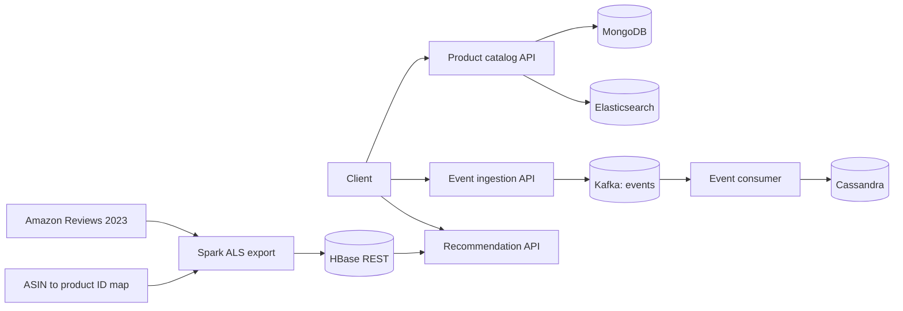

# System architecture

This repository is a local prototype made up of separate APIs, workers, and storage services. Docker Compose provides the data stores; the APIs and event consumer are started as local processes.

## Request and data paths

- The product API exposes `/products` and `/products/search`. It stores product records in MongoDB and indexes created products in Elasticsearch. Reads use MongoDB; text search uses Elasticsearch.
- The event API accepts application interactions at `POST /events` and publishes validated records to Kafka's `events` topic. The consumer validates each message, writes it to Cassandra, then commits the Kafka offset.
- The offline recommendation job reads the Amazon review CSV and the ASIN-to-product-ID mapping, fits Spark ALS, and exports top recommendations as JSON part files. The HBase loader writes those records through HBase REST; the recommendation API reads them by user ID.

## Local services

`compose.yaml` defines single-node MongoDB, Elasticsearch, Kafka, Cassandra, and HBase services. The APIs and Kafka consumer run outside Compose. Host ports are MongoDB 27017, Elasticsearch 9200, Kafka 9094, Cassandra 9042, and HBase REST 8080. The HBase port is bound to loopback. The Compose Elasticsearch node disables security and is for local development.

The Amazon catalog, review extract, and ID crosswalk are local data files and are not checked into this repository. The review and catalog sources are described in the project’s local data notes; this main branch does not contain those source files.

## Monitoring status

The current Compose setup has no Grafana or Prometheus service, and the APIs do not expose a Prometheus metrics endpoint. Grafana screenshots should be captured only after the monitoring dashboard is connected to actual project metrics.
